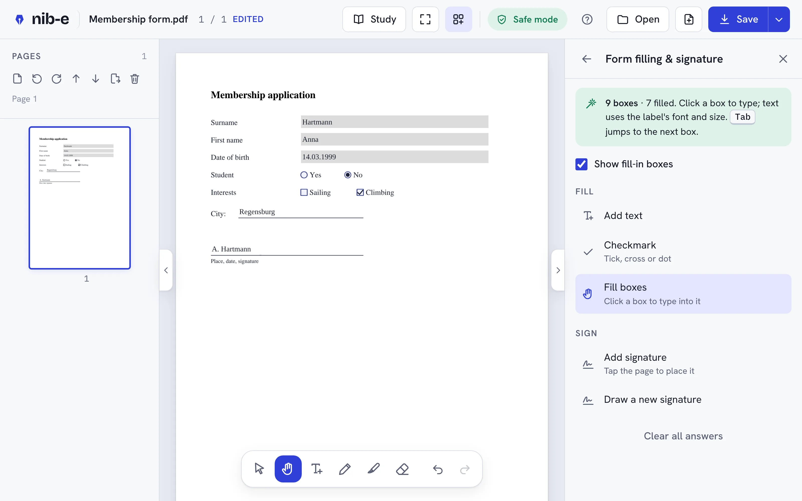

# Nib-E · a private PDF editor (beta)

Part of the Desk-E family.

Read, fill, sign, draw on, redact and organise PDFs in your browser.
**Your files never leave your device:** no uploads, no account, no tracking, no AI.



> **Beta (v0.5.0).** Nib-E is being tested. Things will break; please [report them](TESTING.md).

## Use it

- **Desktop app (Windows, macOS, Linux):** download from the project's **Releases** page.
  The installers are not signed yet, so the first start shows a warning:
  Windows → *More info* → *Run anyway*; macOS → *System Settings → Privacy & Security* → *Open Anyway*.
- **On the web:** open the project's GitHub Pages site and click **Open Nib-E**
  (`https://<user>.github.io/<repo>/`, once Pages is switched on, see below). Works on phones and tablets too.
- **Single file, no install:** download `docs/app/index.html`, rename it `Nib-E.html` if you like, and double-click it.

## Privacy

- **Network: none.** The desktop app has no internet permission (no network code, strict security rules).
  The web version's security rules (CSP) block every connection once the page is loaded.
- Opening, editing and saving all run on your device (PDFium as WebAssembly). Nothing is sent anywhere.
- No account, no analytics, no cookies, no third-party requests (fonts are bundled). No update checks.
- No AI features. A separate, opt-in AI editor may come later as its own product; Nib-E itself stays offline.
- Kept on this device only: settings, a signature you chose to remember, stamps, study notes,
  unsaved-work copies (crash recovery) and the previous version of files you saved over.
  *Tools → Settings → Forget everything* removes them.
- The desktop app can read and write only files you picked (Open/Save window, drag and drop, "Open with").
- **Safe mode:** scripts inside PDFs never run; links, launch actions and attachments can't open anything by themselves.

## Features

| Area | What it does |
|---|---|
| **Tabs** | Several PDFs open at once (up to 8). Double-click the file name to rename. Asks before closing unsaved work; offers unsaved work back after a crash. |
| **Save** | Save writes over the opened file (desktop app, Chrome, Edge), keeps the earlier version (restorable). Save menu: Save as, Export (with notes, flattened, notes only, images, text), Print. |
| **Fill forms** | Real form fields, *and* forms without fields: Nib-E finds boxes, lines and tick boxes and asks whether to make them fillable. Text uses the form's font and size; `Tab` jumps to the next box. Works alongside real fields in the same file. |
| **Sign** | Draw once, place anywhere, optionally remembered on this device. |
| **Draw and write** | Pen and highlighter (stylus pressure, palm rejection, pen feel Precise / Balanced / Smooth), text boxes with font toolbar and spelling check. |
| **Study mode** | PDF beside a notebook; note pages lined, grid or blank. Notes kept on the device as you write and restored (with the last page) when the book is opened again; or written into the book file. Library on the start screen, `.nib` backup. |
| **Comments** | Sticky notes, highlight / underline / strike text, shapes, links, header and footer, watermark. |
| **Stamps** | Ready-made stamps, your own text, a **stamp designer** (drag-and-drop text, shapes, logo, date), or any PNG. Saved in the browser. |
| **Redact** | Removes text and erases picture pixels under the marks, optional removal of hidden data, then verifies nothing is left. |
| **Pages and files** | Insert, rotate, reorder, delete, extract; combine PDFs and images; compress; password (AES-256); export pages as images. |
| **Comfort** | Interface size 100–200 % (default 150 %; phones 100 %), light/dark theme, full-page reading, keyboard shortcuts, Help tour. Phone layout: bottom tool bar, tools sheet, PDF/Notes tabs, two-finger scroll while writing. |

## Put it on GitHub Pages (maintainers)

1. Create a repository on GitHub and upload this folder (everything except `node_modules/`).
2. In the repository: **Settings → Pages → Build and deployment → Deploy from a branch**, branch `main`, folder **`/docs`** → Save.
3. After a minute the site is at `https://<user>.github.io/<repo>/`. The app is at `…/app/`.
4. Optional: **About** (top right of the repo page) → set *Website* to that address.

When you change the code: `npm run pages`, then commit the updated `docs/app/index.html`.

## Build the desktop app (maintainers)

The easy way: **Actions → Desktop app → Run workflow** on GitHub. It builds Windows, macOS and Linux
installers on GitHub's computers (free for public repositories) and puts them in a draft release;
publish the release to make them downloadable. Pushing a tag like `v0.4.0` does the same.

On your own computer (needs [Rust](https://rustup.rs) and, on Linux, `libwebkit2gtk-4.1-dev`):

```
npm install
npm run desktop        # installers in src-tauri/target/release/bundle/
npm run desktop:dev    # app window with live reload
```

The version for installers is in `src-tauri/tauri.conf.json` (`0.5.0`) and `src/version.ts`.

**If the Releases page is empty:** the installers are only made when the workflow runs.
1. Check that `.github/workflows/desktop.yml` is in the repository (uploading in the browser can skip folders that start with a dot).
2. **Actions → Desktop app → Run workflow**. Wait until all three jobs have a green tick (15–25 min).
3. **Releases**: a *draft* release appears. Open it → **Publish release**. Only then do the download links work.

## Develop

Needs Node.js 20+.

```
npm install
npm run dev          # local dev server
npm run typecheck
npm run pages        # build the single-file app into docs/app/
npm test             # pen-feel check + 146 browser checks (Python + Playwright + pikepdf + pdfplumber + poppler)
```

```
src/
  main.ts            start-up, tabs, layout, save/print wiring, recovery, desktop events
  store.ts           open documents (tabs) + per-tab undo/redo
  doc.ts             open, merge, detect; redact / compress / protect / export
  saving.ts          Save (in place, verified, backup), Save as, Export, Print
  library.ts         study library, crash recovery, autosave
  persist.ts         edits to plain data and back
  platform/          files (Open/Save windows, desktop commands), IndexedDB, environment
  pdf/               PDFium helpers, form-box detection, text layer, PDF writer, redaction, nibdata (notes in the file)
  ui/                viewer, tools panel, dock, save menu, library, help tour, stamp designer, spelling
src-tauri/           desktop app (Rust): file commands, Open/Save windows, single instance, security rules
docs/                GitHub Pages site (landing page + app)
test/                end-to-end checks, pen-feel check, fixtures
```

Design: edits are kept as a plan on top of the opened file; Save builds a new PDF from it and (where possible) writes it over the file, after checking it.

## Known limits

- The PDF's own text can't be edited (cover it with a white box and type on top).
- Typed text uses the standard PDF fonts; characters outside Western European sets can't be saved yet.
- Scanned forms (pictures of paper) need OCR, not built yet.
- Spelling uses the browser's own checker and only for text you type.
- Very large PDFs can stutter while pages render.
- Saving changes to a digitally signed PDF invalidates its signature (Nib-E warns first).
- Firefox and Safari have no Save window for web pages: files go to Downloads (or wherever the browser asks). Use Chrome, Edge or the desktop app to save over files.
- Study notes kept "on this device" live in the browser's or app's storage: back them up (.nib) before clearing site data or changing computers.
- Print sends pages as images (150 dpi): fine for reading, not for professional print jobs.
- Phone layout is tested in a phone-sized browser only, not yet on real phones.
- Desktop installers are unsigned (first-start warning). The desktop app was test-run on Linux; Windows and macOS builds come from GitHub Actions and need real-device testing.

## Licences

Nib-E is **MIT licensed** (see [LICENSE](LICENSE)). Desktop app: Tauri (MIT / Apache-2.0).
Third-party parts: PDFium (BSD-3 / Apache-2.0), EmbedPDF (MIT), pdf-lib (MIT), fflate (MIT),
perfect-freehand (MIT), fonts via Fontsource (SIL OFL 1.1).
